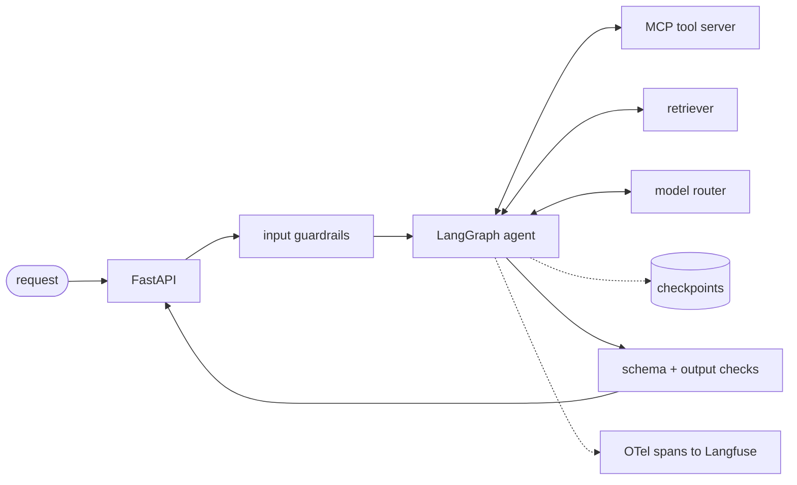

<!-- Before publishing: replace every AGENTIC_REPO and BLOG_URL below with the real links. -->

# Pavan Sai Bellapu

**AI and backend engineer.** Eight years of async Python and distributed systems, the last few spent putting LLMs into production: retrieval, model routing, caching, evals, and the backend underneath all of it.

Bengaluru · [LinkedIn](https://www.linkedin.com/in/pavan-sb/) · [Writing](https://medium.com/@pbellapu09) · [pbellapu09@gmail.com](mailto:pbellapu09@gmail.com)

```text
$ whoami
backend + applied AI engineer · 8 yrs in production · Bengaluru

$ cat ~/scale
6M+ users · 2,000+ schools · 50K+ LLM interactions/month · 100+ req/s under 500 ms

$ cat ~/focus
agents      langgraph · mcp tool servers · tool calling · structured outputs · guardrails
evals       golden sets · ragas · llm-as-judge · promptfoo · regressions fail the build
inference   model routing · context compression · response caching · cost per request
backend     async python · fastapi / tornado · sharded mongodb · redis · gcp cloud run
```

## Shipped in production

**Cloudaccel, 2018–2025.** Multi-tenant parent–teacher communication SaaS on GCP. 6M+ users, 1M+ monthly active, 2,000+ schools.

| | |
|---:|---|
| **$0.003** per LLM call | Production RAG cost after gating calls below a minimum input volume, deduplicating batches (~30% of spend was redundant), routing between Gemini Flash and Pro by task, and cutting token budgets from 8K to 1.2K. 62% below launch cost, ~85% below a GPT-4-class baseline. |
| **50K+** AI calls / month | RAG pipeline (FAISS, transformer embeddings, Gemini via LangChain) generating newsletters and behaviour reports for 2,000+ schools. |
| **99.8%** cache hit rate | Three-level cache, process-local → Redis → MongoDB, with pub/sub invalidation across async instances. Tenant-config reads down 99%, average query latency 45 ms → 18 ms at 100+ req/s. |
| **5,531** queries in one request | Found by an AST-based N+1 detector I wrote to scan 3,712 Python files. The audit catalogued 105+ bottlenecks, including a polling loop behind 80% of autoscaler scale-ups. Shipped the caching fix behind feature flags: ~$20K/yr saved, sub-500 ms P95 on critical endpoints. |
| **500K+** rows / day | MongoDB → BigQuery ETL for message-status records. Protobuf streaming inserts, p99 under 500 ms, inside a 45-minute window. |
| **8** content types | Dialogflow CX agent with multi-turn intent extraction and webhook tool calls. Replaced 8–10-click admin workflows with one sentence. |
| **−40%** number cost | Twilio and Vonage messaging at platform scale: HMAC webhook validation, 10DLC registration, GSM-7 enforcement, number pooling. SMS segment cost also down 15%. |

Also owned: SSO and identity (Google, Microsoft, Clever, ClassLink, SAML), and the sharded newsletter and forms system with translation into 150+ languages.

## Building in the open

Since January 2026 I have been retooling on purpose: agents, evals, observability, fine-tuning. Everything below is public and ships in weekly milestones.

### AGENTIC_REPO · agentic RAG, built like it has to survive production



- **Breaks on purpose.** Failure injection for tool-server outages, retrieval timeouts and malformed tool responses, recovered through retries and checkpoint-resume.
- **Evals gate CI.** Golden dataset, Ragas and LLM-as-judge, Promptfoo regression suite. A quality drop is a red build, not a Slack message.
- **Every call is traced.** LLM, retrieval and tool spans via OpenTelemetry GenAI conventions into Langfuse, with latency and cost-per-request dashboards.
- **Decisions are written down.** Design docs and ADRs. One component is built framework-free against raw model APIs, so I know exactly what LangGraph is doing for me.
- **Next:** multi-agent handoff protocol · episodic + semantic memory with summarisation on overflow · runtime goal decomposition · GKE manifests · AWS Bedrock AgentCore port.

Roadmap: core system → eval harness → observability → deployed demo.

### In progress

- **QLoRA fine-tuning** of Llama 3.1 8B and Qwen2.5 on a single GPU (PEFT, TRL, Unsloth) for structured-output generation. The eval set is written before training; every checkpoint is gated on schema validity and LLM-as-judge against the base model. W&B tracking, DPO next.
- **MLOps pipeline:** MLflow tracking and registry, Airflow orchestration, Evidently drift monitoring into Prometheus and Grafana.

<!--
## Upstream
- vllm-project/vllm #____ : one line on what it fixed
- langchain-ai/langgraph #____ : one line on what it fixed
-->

## Writing

- **[Your LLM eval has the same bug OpenAI's did](https://medium.com/@pbellapu09/your-llm-eval-has-the-same-bug-openais-did-and-why-this-may-be-one-of-the-few-times-we-could-44b451380ccb?sharedUserId=pbellapu09)**: graders that check the outcome and never the method, why that is the default state of CI-gated LLM-as-judge suites, and a six-point checklist for catching it.
- **[Notes from Running MongoDB in Production: What the Internals Actually Look Like](https://medium.com/@pbellapu09/notes-from-running-mongodb-in-production-what-the-internals-actually-look-like-06d7b04bae10?sharedUserId=pbellapu09)**:
- **[RAG and the Bitter Lesson: Why AI Scaffolding Has an Expiry Date](https://medium.com/@pbellapu09/rag-and-the-bitter-lesson-why-ai-scaffolding-has-an-expiry-date-9eeafb00d8c9?sharedUserId=pbellapu09)**
- **[How Claude Code Manages Infinite Sessions Without Blowing the Context Window](https://medium.com/@pbellapu09/how-claude-code-manages-infinite-sessions-without-blowing-the-context-window-8bccb35387fe?sharedUserId=pbellapu09)**

## Toolbox

```text
languages   python (asyncio) · typescript · sql
backend     fastapi · tornado · pydantic · rest · protobuf · pub/sub · webhooks (hmac)
llm         langgraph · langchain · mcp · vertex ai (gemini) · aws bedrock · dialogflow cx
retrieval   faiss · qdrant · embeddings · chunking · semantic search
ml          pytorch · transformers · peft · trl · unsloth · w&b · mlflow
evals/obs   ragas · promptfoo · llm-as-judge · opentelemetry · langfuse · langsmith
data        mongodb (sharding, aggregation) · redis · postgres · bigquery · airflow
infra       gcp (cloud run, cloud tasks, pub/sub) · docker · terraform · jenkins
learning    spark · kafka · dbt · kubernetes
```

## Now

- Contract backend for a B2B logistics platform: live delivery tracking, pub/sub job notifications with accept/decline, support-ticket workflows.
- Shipping the agentic RAG system, one milestone a week.
- Open to senior AI and backend roles. Bengaluru or remote, can join immediately.
